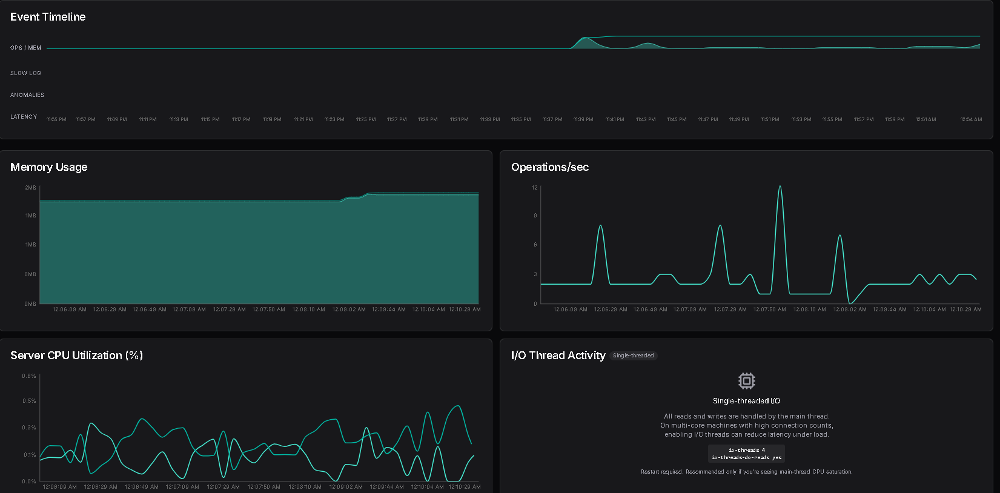
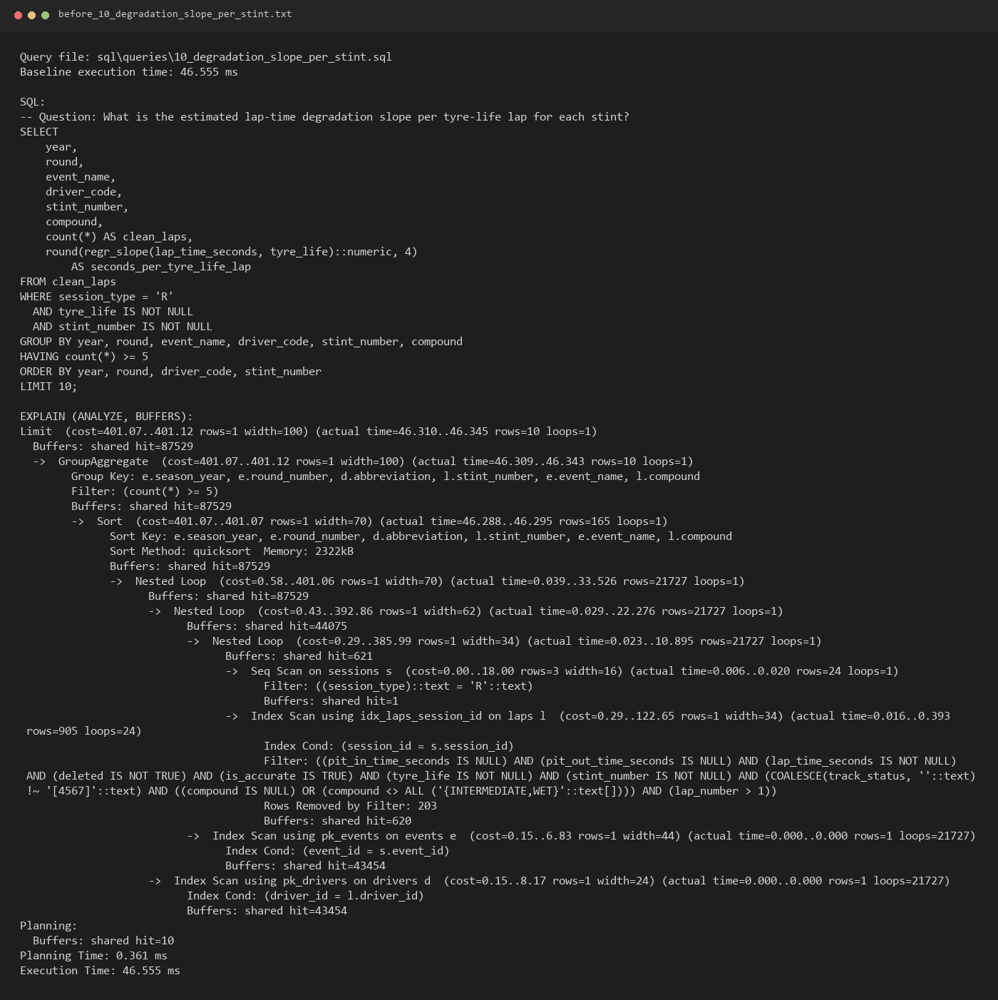
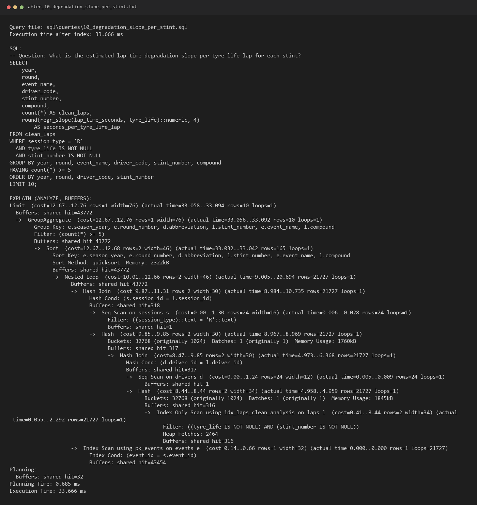
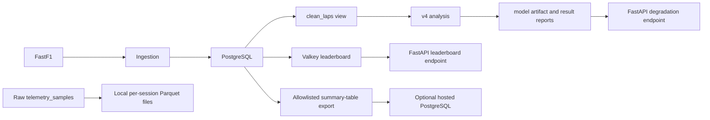

# F1 Telemetry Engine

A reproducible Formula 1 data pipeline that ingests FastF1 race data into PostgreSQL, summarizes lap telemetry, analyses tyre degradation, and serves predictions through a small API.

## Results at a glance

The v4 model estimates compound-specific tyre-age slopes from race-level fixed-effects fits and pools independent races. It uses 60,227 usable laps from 66 race sessions with clean data; 59 eligible full-rank race fits contribute to the headline pools. Six race designs are rank deficient, and four races fall below the 500-clean-lap threshold.

| Compound | Degradation (seconds / tyre-age lap) | 95% interval | Race estimates |
| --- | ---: | ---: | ---: |
| HARD | 0.0507 | 0.0438 to 0.0576 | 58 |
| MEDIUM | 0.0627 | 0.0539 to 0.0714 | 58 |
| SOFT | 0.0902 | 0.0744 to 0.1060 | 51 |

SOFT has the highest estimated degradation; its 95% interval is clearly separate from MEDIUM and HARD, while the MEDIUM and HARD intervals overlap.

Across eligible races, leave-one-race-out relative-time MAE is 1.0199 seconds for the model versus 1.0434 for the zero-degradation baseline. The 2024 chronological holdout (train 2022-2023) is 0.8426 versus 0.9292 seconds. These are exploratory averages, not evidence that every race improves. Full methods, tables, exclusions, diagnostics, validation, and caveats are in [docs/model_results.md](docs/model_results.md); the earlier v3 stint-slope analysis remains in [docs/results_v3.md](docs/results_v3.md), and the flawed v2 specification is preserved in [docs/results_v2_flawed.md](docs/results_v2_flawed.md).

## Example: circuit-level degradation

Circuit pools require at least three eligible race estimates. The Bahrain SOFT pool has a slope of 0.1408 seconds per tyre-age lap (95% interval 0.1149 to 0.1668, three race estimates); the API marks it reliable because its circuit-specific interval is above zero. The Mexico City SOFT pool has a slope of 0.3481 (95% interval -0.2794 to 0.9756, three race estimates); the API marks it unreliable because the wide interval crosses zero. See the [full circuit-pool results](docs/results_v4.md#circuitcompound-pools).

## Sample SQL

These shortened examples are based on the runnable queries in [`sql/queries/`](sql/queries/). Each uses a window function over `clean_laps`.

Rank each driver's fastest clean lap within a race ([full query](sql/queries/03_fastest_laps_ranking.sql)):

```sql
WITH driver_best_laps AS (
    SELECT year, round, event_name, driver_code,
           min(lap_time_seconds) AS fastest_clean_lap_seconds
    FROM clean_laps
    WHERE session_type = 'R'
    GROUP BY year, round, event_name, driver_code
)
SELECT driver_code, fastest_clean_lap_seconds,
       rank() OVER (PARTITION BY year, round ORDER BY fastest_clean_lap_seconds) AS race_rank
FROM driver_best_laps;
```

Find the previous consecutive lap time and lap-to-lap delta ([full query](sql/queries/04_lap_to_lap_delta.sql)):

```sql
WITH lap_changes AS (
    SELECT driver_code, lap_number, lap_time_seconds,
           lag(lap_number) OVER driver_laps AS previous_lap_number,
           lag(lap_time_seconds) OVER driver_laps AS previous_lap_seconds
    FROM clean_laps
    WHERE session_type = 'R'
    WINDOW driver_laps AS (PARTITION BY year, round, driver_code ORDER BY lap_number)
)
SELECT driver_code, lap_number,
       round((lap_time_seconds - previous_lap_seconds)::numeric, 3) AS delta_seconds
FROM lap_changes
WHERE previous_lap_number = lap_number - 1;
```

Calculate the rolling average over three consecutive clean laps ([full query](sql/queries/05_rolling_three_lap_average.sql)):

```sql
WITH rolling_laps AS (
    SELECT driver_code, lap_number, lap_time_seconds,
           lag(lap_number) OVER driver_laps AS previous_lap,
           lag(lap_number, 2) OVER driver_laps AS second_previous_lap,
           avg(lap_time_seconds) OVER (
               driver_laps ROWS BETWEEN 2 PRECEDING AND CURRENT ROW
           ) AS rolling_three_lap_seconds
    FROM clean_laps
    WHERE session_type = 'R'
    WINDOW driver_laps AS (PARTITION BY year, round, driver_code ORDER BY lap_number)
)
SELECT driver_code, lap_number, rolling_three_lap_seconds
FROM rolling_laps
WHERE previous_lap = lap_number - 1
  AND second_previous_lap = lap_number - 2;
```

Example rows from the database-backed leaderboard response documented in the [runbook](docs/runbook.md):

| Driver | Fastest stored lap (seconds) |
| --- | ---: |
| VER | 92.608 |
| LEC | 94.09 |
| ALO | 94.199 |
| PER | 94.364 |
| NOR | 94.476 |

## Caching and query performance

The local Valkey benchmark for the 2024 Bahrain Grand Prix SOFT degradation query returned the following timings. These results depend on this machine and dataset.

| Run | Median | p95 |
| --- | ---: | ---: |
| Uncached database query | 3.517 ms | 5.225 ms |
| Cached hit | 1.117 ms | 2.168 ms |
| Cache miss | 11.019 ms | — |

The measured median speed-up was 3.15x; 10 rows were returned from a table containing 26,604 laps. Full details are in [docs/cache_benchmark.txt](docs/cache_benchmark.txt).

The saved EXPLAIN plans also show lower execution times after adding the clean-lap analysis index: `01_stint_lengths.sql` changed from 48.173 ms to 33.219 ms, and `10_degradation_slope_per_stint.sql` changed from 46.555 ms to 33.666 ms. The latter plan uses `idx_laps_clean_analysis` for an index-only scan where the previous plan used nested loops with session-scoped lap index scans. See the [before](docs/explain/before_01_stint_lengths.txt) and [after](docs/explain/after_01_stint_lengths.txt) stint-length plans and the [before](docs/explain/before_10_degradation_slope_per_stint.txt) and [after](docs/explain/after_10_degradation_slope_per_stint.txt) degradation plans.

<!-- TODO: Add docs/img/betterdb.png after capturing the BetterDB Monitor dashboard. -->


<!-- TODO: Add EXPLAIN screenshots at the paths below; docs/explain currently contains text plans only. -->



## CI and Python

[](https://github.com/Taksh-Doshi/f1-telemetry-engine/actions/workflows/ci.yml)

Python **3.10 or newer** is required (`requires-python` in [pyproject.toml](pyproject.toml)).

## Architecture



Docker Compose provides PostgreSQL 17, Valkey 8, BetterDB Monitor, the API, and an optional ingestion service. The API container runs as a non-root user and binds its published port to localhost by default.

## From a clean clone

The examples below use the repository's existing commands. Create the local Python environment, copy the example environment file, and set its database values before starting the services. Keep `.env` local; never commit it.

| Step | Windows PowerShell | Bash |
| --- | --- | --- |
| Create the Python environment | `python -m venv .venv` | `python -m venv .venv` |
| Activate it | `.\.venv\Scripts\Activate.ps1` | `source .venv/bin/activate` |
| Copy `.env.example` if `.env` is absent | `if (-not (Test-Path .env)) { Copy-Item .env.example .env }` | `test -f .env || cp .env.example .env` |
| Install the project | `python -m pip install -e .` | `python -m pip install -e .` |
| Start PostgreSQL, Valkey, and BetterDB | `docker compose up -d postgres valkey betterdb` | `docker compose up -d postgres valkey betterdb` |
| Apply the numbered SQL schema files | `python -c "from f1engine.db import run_schema; run_schema()"` | `python -c "from f1engine.db import run_schema; run_schema()"` |
| Ingest a season | `foreach ($year in 2022,2023,2024) { python -m f1engine.ingest --season $year; if ($LASTEXITCODE -ne 0) { throw "Ingestion failed for $year" } }` | `python -m f1engine.ingest --season 2024` |
| Train the v4 model and write reports | `python -m f1engine.tyre_model_v4` | `python -m f1engine.tyre_model_v4` |
| Start the API after the model artifact exists | `docker compose up -d --build api` | `docker compose up -d --build api` |
| Call the API | `curl.exe "http://localhost:8000/degradation?circuit=Monza&compound=MEDIUM&tyre_life=10"` | `curl "http://localhost:8000/degradation?circuit=Monza&compound=MEDIUM&tyre_life=10"` |

The API mounts the local `models/` directory, and model files are git-ignored; train the model before starting the API. The schema command is also used by the repository's [CI workflow](.github/workflows/ci.yml).

The model command writes `models/tyre_degradation_v4.joblib`, `docs/results_v4.md`, and `docs/model_results.md`. The notebook version of this analysis is [notebooks/04_degradation_v4.ipynb](notebooks/04_degradation_v4.ipynb).

## API

The API is available at `http://localhost:8000` after starting the Compose services. `GET /health` checks that the process is responsive. The degradation endpoint returns an estimate, interval, reliability flag, scope, and warning:

```powershell
curl.exe "http://localhost:8000/degradation?circuit=Monza&compound=MEDIUM&tyre_life=10"
```

The prediction reports cross-circuit fallback when a circuit/compound pool does not meet the minimum race count. It retains negative estimates and marks fallback or low-confidence predictions as unreliable. The leaderboard endpoint reads the current Valkey sorted set:

```powershell
curl.exe "http://localhost:8000/leaderboard/2024/1?n=5"
```

Populate a leaderboard from a race with:

```powershell
python -m f1engine.leaderboard 2024 1
```

The `/health` endpoint indicates API process health; it is not a full PostgreSQL or Valkey readiness check.

## Data exports

Raw telemetry samples are opt-in during ingestion because they are much larger than lap summaries:

```powershell
python -m f1engine.ingest 2024 1 --telemetry-samples --drivers VER,LEC
python -m f1engine.export_parquet --session-id SESSION_ID
```

Parquet files are written under `data/parquet/`, which is ignored by Git. The read helpers support one session or all exported sessions.

The hosted PostgreSQL exporter is restricted to an allowlist: events, sessions, drivers, laps, stints, weather, and lap telemetry summaries. It estimates the source size and refuses to exceed its default 400 MB limit. Set `HOSTED_DATABASE_URL` in your local `.env` to your own destination, then run:

```powershell
python -m f1engine.export_hosted --max-mb 400
```

Raw `telemetry_samples` are not included in the hosted export. The project's own hosted copy lives on Supabase Postgres: 7 tables, 164,369 rows, about 36 MB, with lap-level summaries only. The connection string is kept in the local `.env` and is not part of the repository.


## Project structure

```text
.
├── .github/workflows/ci.yml
├── docker/                 # API image
├── docs/                   # Runbook, model results, benchmark, and EXPLAIN plans
├── notebooks/              # Exploratory and degradation analyses
├── models/                 # Generated, git-ignored model artifacts
├── sql/
│   ├── queries/            # Example analytical SQL
│   └── schema/             # Numbered PostgreSQL schema files
├── src/f1engine/           # Ingestion, analysis, API, cache, and exports
├── tests/
├── compose.yaml
├── pyproject.toml
└── requirements.txt
```

## Project status

The local pipeline is implemented through the v4 tyre-degradation analysis and includes database ingestion, a Valkey leaderboard, a Dockerized API, per-session Parquet exports, and an optional allowlisted export of summary tables to hosted PostgreSQL. CI separates offline unit tests from tests requiring PostgreSQL.

## Tests and checks

The default test command runs the offline unit suite. The database integration test is deliberately marked separately:

```powershell
python -m pytest
python -m pytest -m integration
python -m pytest -m "integration or not integration"
ruff check src tests
docker compose config --quiet
```

The GitHub Actions workflow runs the unit and PostgreSQL integration jobs separately. The combined marker expression runs the entire suite locally; integration tests require the configured PostgreSQL service.

## Results and limitations

The v4 estimator controls for driver, race lap, and compound intercepts within each race, then estimates compound-specific tyre-age slopes. Only full-rank race designs with at least 500 clean laps contribute to the headline fit. Circuit/compound predictions require at least three eligible race estimates; otherwise, the API falls back to the cross-circuit pool.

Fuel burn is not measured directly; the analysis uses sensitivity assumptions. Race-lap fixed effects absorb the shared linear fuel trend, which the synthetic fuel-mismatch experiment confirms for this model design. The cleanliness view excludes pit-affected, wet-compound, safety/red-flag, inaccurate/deleted, and opening laps, with overlapping reasons possible. Some circuits have few qualifying races and wide intervals. Weekend compound labels do not identify Pirelli's underlying C1-C5 rubber. Drivers may pit before severe fall-off, creating survivorship bias. This is not a causal wear estimate, detected physical cliff, or pit-strategy recommendation. See the complete [v4 results and limitations](docs/model_results.md).

## Roadmap

- Extend validation to more seasons and track conditions as data coverage grows.
- Add race-strategy analysis with explicit stint, pit-stop, and safety-car uncertainty.
- Evaluate forecast calibration and decision value before presenting strategy recommendations.

## Local monitoring

BetterDB Monitor is available at [http://localhost:3001](http://localhost:3001). Generate activity with `python -m f1engine.bench_cache` and the leaderboard command. The current in-memory monitor storage does not support every key analytics metric; some dashboard metrics may therefore be unavailable.
